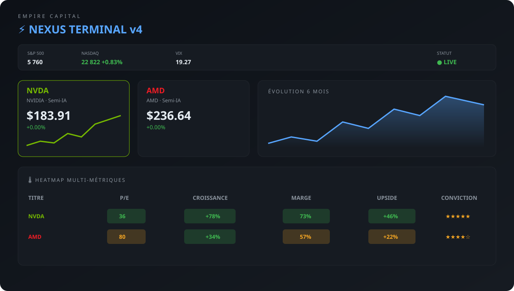

# Nexus Terminal

Interface de suivi et d'analyse boursière conçue pour **Empire Capital**.
Le projet présente un terminal financier interactif en français, alimenté par des
données simulées.

## Aperçu



L'interface propose une vue globale des titres suivis, une fiche détaillée, une
heatmap multi-métriques et un comparatif avec radar.

## Fonctionnalités

- Suivi de NVDA, AMD, Oracle et Tesla
- Prix simulés avec rafraîchissement automatique
- Signaux `ACHETER`, `SURVEILLER` et `ATTENDRE`
- Objectifs T1/T2/T3, zone d'entrée et stop loss
- Analyse des fondamentaux : P/E, croissance, marge brute et BPA
- Heatmap colorée et tableau comparatif
- Graphiques historiques, graphiques en barres et radar
- Guides intégrés sur les indicateurs et le ratio risque/rendement
- Thème sombre et clair dans la version HTML
- Navigation clavier entre les titres dans la version React

## Structure du dépôt

```text
.
├── nexus-terminal-v4.jsx       # Source React complète avec Recharts
├── nexus-terminal-react.html   # Démonstration autonome dans le navigateur
├── docs/
│   └── nexus-terminal-preview.svg
└── README.md
```

## Technologies

- React 18
- JSX
- Recharts pour les visualisations
- CSS intégré et styles inline
- Babel Standalone dans la démonstration HTML

## Utilisation

### Version HTML

Ouvrez `nexus-terminal-react.html` dans un navigateur moderne. Cette version
contient l'interface et le CSS directement dans le fichier et charge React
depuis des CDN.

### Version React

`nexus-terminal-v4.jsx` est un composant React exporté par défaut. Intégrez-le
dans une application React existante, puis installez les dépendances nécessaires
(`react`, `react-dom` et `recharts`) avec le gestionnaire de paquets de votre
projet.

## Données

Les données de marché sont fictives et servent uniquement à la démonstration.
Ce projet ne fournit pas de conseil financier et ne se connecte à aucune API de
marché ou base de données.

## État du projet

Prototype d'interface en phase de fondation. Le dépôt ne contient actuellement
ni backend, ni authentification, ni persistance des données, ni configuration
de build.
